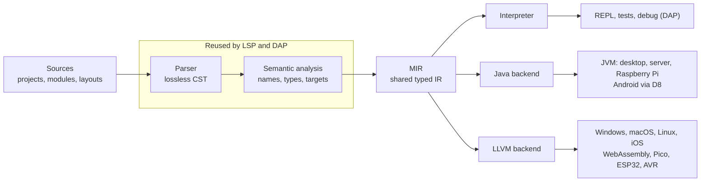

# FerroBASIC architecture

Version 0 · October 2026

The parser and analysis are shared by the compiler, the REPL and the editor
tooling; a new target is just one more backend fed by the MIR.

## Goals and non-goals

**Goals**

- Open an existing B4X project folder and build it with no edits to code,
  project files or layouts (see [porting.md](porting.md)).
- Compile the same source to JVM and Android, native (Windows, macOS, Linux,
  iOS), WebAssembly and microcontrollers.
- Measure compatibility with conformance and differential tests against the
  original toolchain (see [compatibility-testing.md](compatibility-testing.md)).
- A complete experience in VS Code and in any editor that speaks LSP and DAP.
- The interpreter is the semantic reference: every backend must produce the
  same output.

**Non-goals, for now**

- Cloning the B4X IDE or its visual designer; its project and layout files are
  read as they are.
- Running a library on a platform it was not written for (a Java library on
  iOS, inline Java on WASM): the compiler reports it instead.
- Using the B4X name or trademark.

## Pipeline

## Semantics (summary)

Every implicit B4X conversion becomes an explicit node in the MIR, so the
interpreter and all backends implement it the same way. Details and the type
table are in [spec/level0.md](spec/level0.md).

- **Events (Level 1)**: a Sub named `Prefix_Event` binds to the object
  initialized with that prefix; binding is resolved at compile time when possible.
- **Wait For and Sleep (Level 2)**: each resumable sub becomes a state machine
  with a heap frame in the MIR. On the JVM it is an object with a state field;
  on LLVM the same state machine, without relying on LLVM coroutines.
- **Memory**: GC on the JVM; reference counting (ARC) on native targets, with
  cycles documented; an embedded profile limits dynamic allocation.

## IR and backends

The MIR is a typed, desugared IR: no `For Each`, smart strings or implicit
conversions, only blocks, jumps, calls and explicitly typed operations. LLVM is
one of the backends, not the project's IR.

| Target | Backend | Memory | Approach |
| --- | --- | --- | --- |
| JVM: desktop, server, Raspberry Pi | Java | JVM GC | Java source + `javac` first, direct bytecode later |
| Android | Java | ART GC | Same backend, then D8 for DEX |
| Windows, macOS, Linux | LLVM | ARC | Native executable with the runtime linked in |
| iOS | LLVM (arm64) | ARC | Bridging to the Objective-C runtime for system APIs |
| WebAssembly | LLVM (wasm32) | ARC | WasmGC to evaluate later |
| Raspberry Pi Pico (RP2040/RP2350) | LLVM (thumbv6m/v8m) | embedded profile | First microcontroller target |
| ESP32 | Espressif LLVM fork or C backend | embedded profile | C backend as plan B |
| Arduino AVR | LLVM AVR or C backend | embedded profile | After the Pico |
| REPL and tests | Interpreter | interpreter runtime | Semantic reference |

The native runtime (`crates/runtime`: strings, `List`, `Map`, exceptions,
refcounting) is written once and builds for desktop, WASM and `no_std` on
microcontrollers.

Possible additions, not decided: Cranelift for a JIT-backed REPL and fast
debug builds on desktop; `zig cc` / `cargo-zigbuild` as the cross-linker.

## Tooling: REPL, LSP, DAP, VS Code

The tooling reuses the compiler's parser and analysis: there is no second
implementation of the language inside the extension.

1. **One CLI** (`ferro`) with the commands `check`, `run`, `bundle`, `compile`, `targets`,
   `build`, `repl`, `test` and `fmt` (see `docs/spec/cli.md`, "Commands").
2. **REPL** on the interpreter: accepts statements and whole Subs, keeps state between inputs.
3. **Language Server**, in this order: diagnostics, type hover, completion,
   go to definition, rename, formatting.
4. **Debug Adapter** on the interpreter: breakpoints, stepping, locals. Native
   binaries are debugged through LLDB later.
5. **Tree-sitter grammar** for highlighting and folding in editors that support it.
6. **Thin VS Code extension**: starts LSP and DAP, registers build tasks. The
   layout designer arrives with M6, previewing B4X layouts in a webview.

## Technical choices

| Decision | Choice | Notes |
| --- | --- | --- |
| Compiler language | Rust | inkwell for LLVM, rowan for the CST, salsa for incrementality, tower-lsp |
| First real backend | Java source, as B4X does | Direct bytecode through a class-file library later |
| License | MIT | Permissive, so programs built with FerroBASIC carry no conditions beyond the notice; see `LICENSE` |
| Project name | FerroBASIC | CLI `ferro`, crates `ferro-*` |
