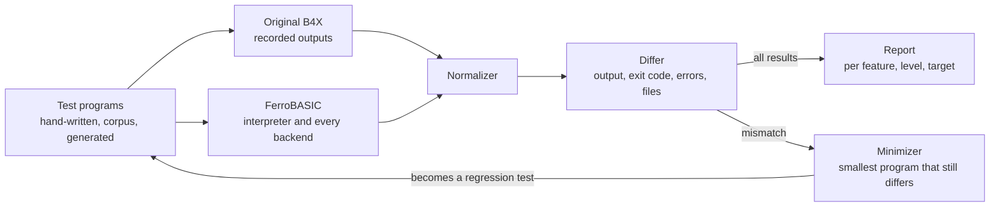

# Compatibility testing

Compatibility is measured, not claimed: the same programs run on the original
B4X toolchain and on FerroBASIC, and every difference in observable behaviour
is either a bug or a documented deviation. It starts in M0 and becomes the gate
of every milestone.



## The oracle

- Levels 0–2: the original B4J compiles each console program from the command
  line and runs it on the JVM. B4A follows on an Android emulator (comparing
  logcat), B4R on real boards (comparing serial output).
- What counts as behaviour: `Log` output, exit status, uncaught exceptions
  (type, not message text), files written.
- Negative tests: an invalid program must be rejected by both toolchains; error
  messages are not compared.

## Record and replay

- B4X is proprietary and its IDE runs on Windows, so it does not run in CI. A
  recording machine runs each test once on the reference with
  `tools/recorder` ([its README](../tools/recorder/README.md)), which writes
  `*.expected` and the `*.meta.toml`'s `[recording]` table: B4X version,
  platform, Java, locales, date. The recorder writes into a separate folder,
  applied to the repository in a pull request.
- The reference locale is `en-US`, forced for every locale category. Each
  test also runs in the recording machine's own locale; when that output
  differs, it is kept as `<name>.<locale>.expected` (for example
  `it-IT`), which the harnesses ignore for now: it is evidence of
  locale-dependent behaviour.
- Deviation tests are run too, but get no `.expected` file (FerroBASIC knowingly
  differs from it): their output is compared by hand with the reference output
  in their `.meta.toml`.
- CI compares FerroBASIC's outputs with the recordings only. A new B4X release
  triggers a re-recording, and changes between versions are reported.

## Test file layout

```text
tests/conformance/level0/
  <name>.bas          program body (code module, B4J console)
  <name>.meta.toml    status, level, features, and recording metadata
  <name>.expected     recorded output (written only by tools/recorder)
  <name>.provisional  hand-derived output, used only while there is no .expected
```

`status` in `.meta.toml` is one of `pending-recording`, `recorded`,
`deviation` (see `docs/deviations.md`) or `negative` (must be rejected).
A test whose program must stop on an uncaught error names its kind in
`uncaught_error` (for example `"java.lang.RuntimeException"`), and exits
with code 1. A test whose program ends with `ExitApplication2(n)` gives the
code as `exit_code = n` (0 to 255; not with `uncaught_error`, and not for a
program FerroBASIC rejects). Otherwise the program must exit with code 0.

Two more keys describe what FerroBASIC does, for the tests it handles
differently from B4X:

- `deviation = "D1"`: required for a `deviation` test, and only there; the
  entry in `docs/deviations.md`.
- `ferro_rejects = true`: FerroBASIC refuses to compile the program on
  purpose, either by a documented deviation or until a recording shows what
  B4X does (for a `pending-recording` test of an open question). Such a test
  has no `.provisional` output.

Every crate's harness reads the corpus through `crates/corpus` (all
subdirectories of `tests/conformance`; a missing `.meta.toml`, an unknown
`status` or an empty corpus is an error). The front-end harness checks that
every program FerroBASIC accepts parses and type-checks cleanly, and that
every one it rejects (`negative`, or `ferro_rejects`) gets an error. The
later stages only run the accepted ones.

Git must not convert the line endings of these files: `.gitattributes`
marks `tests/conformance/**` as binary-exact (`-text`).

### Provisional outputs

Until a test is recorded, it may carry a `<name>.provisional`
file: its expected stdout, derived by hand from the sources in
[research/level0-semantics.md](research/level0-semantics.md). Rules:

- Only for behaviour the research marks as settled by `source`, `generated`,
  `docs` or `forum`; the basis and the links go in a `[provisional]` table of the
  `.meta.toml`. Behaviour marked *open* gets no provisional output: the test
  stays pending with no expectation.
- A `.provisional` file never overrides an `.expected` one. When the recorder
  writes `<name>.expected`, it drops the `[provisional]` table and lists
  `<name>.provisional` for deletion; a disagreement between the two is
  reported, and the research and specs are fixed to match the recording.
- The report counts passes against provisional outputs separately from passes
  against recordings. Only the latter count for a milestone gate from M2 on.
- Values computed by running Java code from the open-source runtime (for
  example number formatting) are `source` basis; record the JDK version used.

## Where test programs come from

1. Hand-written conformance tests, at least one per language feature.
2. A real-world corpus of open source B4X projects whose licences allow it,
   first measured as parse rate and type-check rate (`tests/corpus/`).
3. Generated programs (`crates/progen`): a generator driven by the EBNF and the
   type rules produces well-typed, terminating Level 0 programs with bounded
   loops. Each mismatch is shrunk by delta debugging and kept as a regression test.

## Normalization

- Line endings, temporary paths and timestamps are normalized (Level 0 output
  has only line endings to normalize).
- Number-to-string formatting is visible behaviour, so it must match B4X, not
  be normalized away.
- `Map` iteration order must match B4X too (insertion order, to verify).

## The report

A compatibility matrix by feature, language level and target, with four states:
pass, fail, documented deviation, pending. Accepted deviations live in
`docs/deviations.md`.

The headline number, per target, is the share of corpus projects that build
without changes and behave identically to the original.

`ferro-difftest` prints it for the conformance corpus:

```sh
cargo run -p ferro-difftest                     # target interp
cargo build -p ferro-cli
cargo run -p ferro-difftest -- --target standalone
cargo run -p ferro-difftest -- --verbose --by-feature --filter sort
```

- `interp` runs each program the way `ferro run` does, in process: the module
  header checked, then parsed, type-checked and interpreted on `ferro`'s
  stack, with the exit code's low 8 bits. `standalone` builds it with
  `ferro bundle` (the `ferro` next to `ferro-difftest`, or `--ferro <path>`)
  in a folder of its own under the system's temporary folder (or under
  `--work`), removed after, and runs the binary, reading the uncaught error's
  kind from its stderr.
- Tests run several at a time, each for at most 60 seconds (`--timeout`): a
  program still running then fails, so a loop that never ends cannot hang
  the report.
- A test passes when its normalized stdout, uncaught error kind and exit code
  are the recorded ones; a `negative` test passes when it is rejected. Passes
  against a `.provisional` output are counted apart; a `recorded` test with
  no `.expected` fails. A test refused that must build fails with the first
  diagnostic.
- A `deviation` test is reported as one when it runs, or when it is rejected
  with `ferro_rejects`. Its reference output is described in its `.meta.toml`
  in prose, so it is not compared yet.
- A `pending-recording` test is pending; it fails if FerroBASIC accepts what
  it marks `ferro_rejects`, or rejects what it does not.
- The report lists the failures with the first differing line, then counts
  each state by level, and by feature with `--by-feature`. The exit code is 0
  when nothing fails, 1 otherwise, 2 on a usage error.

The two targets also run as tests: `crates/difftest` on the interpreter, and
`crates/cli/tests/difftest.rs` as standalone binaries.

## CI

`.github/workflows/ci.yml` runs on GitHub Actions:

- `fmt` and `clippy` on Linux;
- `clippy` and `cargo test --workspace` (every conformance test, in the
  interpreter and as a standalone binary) on Linux x86_64, Windows, macOS
  arm64 and macOS Intel;
- a static Linux build (`x86_64-unknown-linux-musl`), checked by bundling a
  program and running it.

It runs on pull requests into `main` (releases) and on demand ("Run
workflow"), not on pull requests into `dev`: the repository is private, so
every minute comes out of the owner's Actions allowance, and macOS minutes
count ten times. Pull requests into `dev` are checked locally (AGENTS.md):
`fmt`, `clippy` (also for `x86_64-pc-windows-gnu`, `aarch64-apple-darwin` and
`x86_64-apple-darwin`) and the tests. Run the workflow by hand before a
release, and after a change to platform-specific code (`ferro bundle`, files,
the command line). A release is merged only with the workflow green.

## Open points

Tracked in [open-questions.md](open-questions.md#compatibility-testing).
