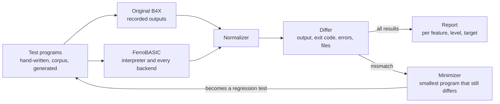

# Compatibility testing

Compatibility is measured, not claimed: the same programs run on the original
B4X toolchain and on FerroBASIC, and every difference in observable behaviour
is either a bug or a documented deviation. It starts in M0 and becomes the gate
of every milestone.



## The oracle

- Levels 0–2: the original B4J compiles each console program from the command
  line and runs it on the JVM. B4A follows on an Android emulator (comparing
  logcat), B4R on real boards (comparing serial output).
- What counts as behaviour: `Log` output, exit status, uncaught exceptions
  (type, not message text), files written.
- Negative tests: an invalid program must be rejected by both toolchains; error
  messages are not compared.

## Record and replay

- B4X is proprietary and its IDE runs on Windows, so it does not run in CI. A
  recording machine runs each test once on the reference with
  `tools/recorder` ([its README](../tools/recorder/README.md)), which writes
  `*.expected` and the `*.meta.toml`'s `[recording]` table: B4X version,
  platform, Java, locales, date. The recorder writes into a separate folder,
  applied to the repository in a pull request.
- The reference locale is `en-US`, forced for every locale category. Each
  test also runs in the recording machine's own locale; when that output
  differs, it is kept as `<name>.<locale>.expected` (for example
  `it-IT`), which the harnesses ignore for now: it is evidence of
  locale-dependent behaviour.
- Deviation tests are run too, but get no `.expected` file (FerroBASIC knowingly
  differs from it): their output is compared by hand with the reference output
  in their `.meta.toml`.
- CI compares FerroBASIC's outputs with the recordings only. A new B4X release
  triggers a re-recording, and changes between versions are reported.

## Test file layout

```text
tests/conformance/level0/
  <name>.bas          program body (code module, B4J console)
  <name>.meta.toml    status, level, features, and recording metadata
  <name>.expected     recorded output (written only by tools/recorder)
  <name>.provisional  hand-derived output, used only while there is no .expected
```

`status` in `.meta.toml` is one of `pending-recording`, `recorded`,
`deviation` (see `docs/deviations.md`) or `negative` (must be rejected).
A test whose program must stop on an uncaught error names its kind in
`uncaught_error` (for example `"java.lang.RuntimeException"`), and exits
with code 1. A test whose program ends with `ExitApplication2(n)` gives the
code as `exit_code = n` (0 to 255; not with `uncaught_error`, and not for a
program FerroBASIC rejects). Otherwise the program must exit with code 0.
For a `deviation` test, they give FerroBASIC's documented ending: B4X's is
described in the comments, with its output.

Two more keys describe what FerroBASIC does, for the tests it handles
differently from B4X:

- `deviation = "D1"`: required for a `deviation` test, and only there; the
  entry in `docs/deviations.md`.
- `ferro_rejects = true`: FerroBASIC refuses to compile the program on
  purpose, either by a documented deviation or until a recording shows what
  B4X does (for a `pending-recording` test of an open question). Such a test
  has no `.provisional` output.

Every crate's harness reads the corpus through `crates/corpus` (all
subdirectories of `tests/conformance`; a missing `.meta.toml`, an unknown
`status` or an empty corpus is an error). The front-end harness checks that
every program FerroBASIC accepts parses and type-checks cleanly, and that
every one it rejects (`negative`, or `ferro_rejects`) gets an error. The
later stages only run the accepted ones.

Git must not convert the line endings of these files: `.gitattributes`
marks `tests/conformance/**` as binary-exact (`-text`).

### Provisional outputs

Until a test is recorded, it may carry a `<name>.provisional`
file: its expected stdout, derived by hand from the sources in
[research/level0-semantics.md](research/level0-semantics.md). Rules:

- Only for behaviour the research marks as settled by `source`, `generated`,
  `docs` or `forum`; the basis and the links go in a `[provisional]` table of the
  `.meta.toml`. Behaviour marked *open* gets no provisional output: the test
  stays pending with no expectation.
- A `.provisional` file never overrides an `.expected` one. When the recorder
  writes `<name>.expected`, it drops the `[provisional]` table and lists
  `<name>.provisional` for deletion; a disagreement between the two is
  reported, and the research and specs are fixed to match the recording.
- The report counts passes against provisional outputs separately from passes
  against recordings. Only the latter count for a milestone gate from M2 on.
- Values computed by running Java code from the open-source runtime (for
  example number formatting) are `source` basis; record the JDK version used.

### Current recording status

[Run 24](research/recording-run-24.md) (2026-11-21) recorded 123 tests:
the 78 negative and 6 deviation tests, and 39 Level 0 probes. Both
conformance targets report **353 tests, 325 passing, 6 documented
deviations, 0 failures, 22 pending and 0 passes against provisional
output**. Passes include negative tests rejected as expected. Of the 39
probes, 19 were refused and are negative tests, and 6 recordings pass;
the other 14 recordings wait, pending, for the FerroBASIC changes that pass
them (Map iteration, Null comparisons, a `Process_Globals` read). The 8
other pending tests are new probes for the next run. No
`.provisional` files remain. The conformance gate is
satisfied, and the first M1 [Language Server diagnostics](language-server.md)
are implemented
([roadmap](roadmap.md#m1-task-breakdown-second-part-complete)).

`status` is the test classification, not a recording timestamp. Negative and
deviation tests keep their classification after recording. `[recording]`
records provenance: `product`, `version`, `platform`, `java`, `locale`,
`machine_locale`, optional `machine_locale_output` (`same` or `differs`) and
`date`. For a test B4J refused to build, it also has `rejected = true`,
followed by B4J's error and the line it names as comments when the builder
output has them. This is distinct from top-level `ferro_rejects`, which
describes FerroBASIC acceptance. A negative test keeps its status. A pending
probe B4J refuses keeps `status = "pending-recording"` (and its
`[provisional]` table), and `report.md` lists it as "refused by the original
toolchain: decide whether it is negative": a refusal can also mean the probe
is wrong, so a person classifies it, as for
[`for_each_over_non_collection_object`](../tests/conformance/level0/for_each_over_non_collection_object.meta.toml).
Until then it loads and counts as pending, like any other pending test. A
build that fails without an error in a form the recorder reads is reported
as "build failed", with the builder output and no metadata.

## Where test programs come from

1. Hand-written conformance tests, at least one per language feature.
2. A real-world corpus of open source B4X projects, first measured as parse
   rate and type-check rate. The projects are referenced, not copied:
   `tests/corpus/corpus.toml` gives each one's URL, commit, licence and the
   SHA-256 of each file, and `ferro-corpus-fetch` downloads them into
   `target/corpus` ([tests/corpus/README.md](../tests/corpus/README.md)).
   The tests that need them are `#[ignore]`d, so `cargo test --workspace`
   needs no corpus download; run them with `--ignored` after fetching. Cargo
   may still need network access to obtain Rust dependencies on a fresh machine.
3. Generated programs (`crates/progen`, planned): a generator driven by the EBNF and the
   type rules produces well-typed, terminating Level 0 programs with bounded
   loops. Each mismatch is shrunk by delta debugging and kept as a regression test.

## Normalization

- Line endings, temporary paths and timestamps are normalized (Level 0 output
  has only line endings to normalize).
- Number-to-string formatting is visible behaviour, so it must match B4X, not
  be normalized away.
- `Map` iteration order must match B4X too: insertion order, confirmed by
  [`map_order`](../tests/conformance/level0/map_order.expected).

## The report

A compatibility matrix by feature, language level and target, with four states:
pass, fail, documented deviation, pending. Accepted deviations live in
`docs/deviations.md`.

The headline number, per target, is the share of corpus projects that build
without changes and behave identically to the original.

`ferro-difftest` prints it for the conformance corpus:

```sh
cargo run -p ferro-difftest                     # target interp
cargo build -p ferro-cli
cargo run -p ferro-difftest -- --target standalone
cargo run -p ferro-difftest -- --verbose --by-feature --filter sort
```

- `interp` runs each program the way `ferro run` does, in process: the module
  header checked, then parsed, type-checked and interpreted on `ferro`'s
  stack, with the exit code's low 8 bits. `standalone` builds it with
  `ferro bundle` (the `ferro` next to `ferro-difftest`, or `--ferro <path>`)
  in a folder of its own under the system's temporary folder (or under
  `--work`), removed after, and runs the binary, reading the uncaught error's
  kind from its stderr.
- Tests run several at a time, each for at most 60 seconds (`--timeout`): a
  program still running then fails, so a loop that never ends cannot hang
  the report.
- A test passes when its normalized stdout, uncaught error kind and exit code
  are the recorded ones; a `negative` test passes when it is rejected. Passes
  against a `.provisional` output are counted apart; a `recorded` test with
  no `.expected` fails. A test refused that must build fails with the first
  diagnostic.
- A `deviation` test is reported as one when it runs, or when it is rejected
  with `ferro_rejects`. Its reference output is described in its `.meta.toml`
  in prose, so it is not compared yet; its `uncaught_error` and `exit_code`
  are FerroBASIC's documented ones, and are checked. So are a pending
  test's.
- A `pending-recording` test is pending; it fails if FerroBASIC accepts what
  it marks `ferro_rejects`, or rejects what it does not.
- The report lists the failures with the first differing line, then counts
  each state by level, and by feature with `--by-feature`. The exit code is 0
  when nothing fails, 1 otherwise, 2 on a usage error.

The two targets also run as tests: `crates/difftest` on the interpreter, and
`crates/cli/tests/difftest.rs` as standalone binaries.

## Comparing two builds

A change to how programs are checked can accept or refuse more than it
means to. `ferro-compare` shows what it changes: it runs `ferro check` from
two builds on generated programs, and lists the programs whose result
changed. It compares FerroBASIC with itself, not with B4J: whether a change
is right is for the recordings to say, and a program newly accepted that no
recording settles is a bug.

```sh
cargo run -p ferro-compare                       # against origin/dev
cargo run -p ferro-compare -- --old 4e7f547 --family const --examples 5
cargo run -p ferro-compare -- --list             # the families
```

- The new `ferro` is built from the checkout `ferro-compare` belongs to, as
  it is, into the target folder `ferro-compare` runs from, so a stale build
  is never compared; `--new-ferro <path>` takes a build instead, and is
  needed when `ferro-compare` runs from elsewhere (`cargo install`). Git
  and cargo run in that checkout, wherever `ferro-compare` is run from.
- The old `ferro` is built from a git ref (`--old`, by default `origin/dev`,
  fetched first) in a worktree of its own, removed after; its target folder
  is kept under `target/compare`, so later builds are quick. When the
  checkout does not contain that ref, a warning says so: what changed there
  since would show as the checkout's own changes. `--old-ferro <path>` takes
  a build instead.
- One run at a time uses a work folder (`--work`, by default
  `target/compare`): a second one is refused while the first holds its
  `lock` file, which names the run's process; a lock left by a run that was
  stopped (Ctrl-C) is taken over.
- Each family covers one area with every combination of a few building
  blocks: `const` (declarations of one name in `Process_Globals`, then each
  use of it, in several layouts), `sub-named-loops` (one to three loops
  over a variable named like a Sub), `comparisons` (each operator
  between operands of each type, and two comparisons in a row) and
  `declarations` (one to three statements that declare, assign, read or
  loop over one name, in source order, as a plain local, next to a
  parameter or a module variable, or in `Process_Globals`). The
  programs are written under
  `target/compare/programs`, to read or re-run one by hand.
- The programs run several at a time (`--jobs`, by default one per
  processor), each for at most 30 seconds (`--timeout`): about 94,000
  programs take about three minutes with both builds on four processors.
- The report counts the programs that crash (or time out) in the new build
  only, in both, or in the old one only, are newly accepted, newly refused,
  have more or fewer errors, or the same number of other ones, then shows
  the smallest of each (`--examples`) with both builds' errors. The exit
  code is 1 when the new build alone crashes on a program, 0 otherwise, 2 on
  a usage error or a failed build.

Unlike the planned generator of "Where test programs come from"
(`crates/progen`), which makes well-typed programs to compare their output
across targets, these families are mostly programs a build should refuse,
to compare what it checks.

## Local checks

`cargo test --workspace` runs non-ignored unit, integration and doc tests:
syntax/project/HIR/MIR/interpreter checks, interpreter and standalone
conformance, CLI behavior, REPL sessions/tutorial transcripts, corpus metadata
and recorder tests. It does not run format or Clippy, the explicit
`ferro-difftest` reports, `ferro-recorder --dry-run`, the ignored downloaded
project tests, or the static Linux build. It exercises the host OS;
cross-target Clippy checks compilation but does not execute foreign binaries.
On Linux, CLI REPL tests also run `scripts/test-repl-terminal.py` using Python 3's
standard-library PTYs. They exercise real editing, multiline recall, control
commands, prompt/output routing, redirected streams, fallback, EOF, Ctrl+C and
terminal restoration. Python 3 is required for this Linux test. Windows and
macOS compilation does not establish terminal runtime behavior on those OSes.

Before every push into a `dev` PR, run:

```sh
scripts/check-all.sh
```

For docs/comments-only changes, use this alternative to skip the static Linux
release build:

```sh
scripts/check-all.sh --quick
```

The script needs rustup, rustfmt, Clippy and the Rust standard libraries for
`x86_64-unknown-linux-gnu`, `x86_64-pc-windows-gnu`,
`aarch64-apple-darwin` and `x86_64-apple-darwin` (install missing ones with
`rustup target add <target>`). Corpus fetching also needs `curl`; the static
check needs the musl target and `file`. A fresh environment has only its
host's target; one command installs the rest, the musl target included
(a target already installed is left as it is):

```sh
rustup target add x86_64-unknown-linux-gnu x86_64-pc-windows-gnu aarch64-apple-darwin x86_64-apple-darwin x86_64-unknown-linux-musl
```

A missing clippy target stops the script. A missing musl target does not: on
Linux x86_64 the script then skips the static Linux binary, so the run counts
only as a `--quick` run. It stops at the first failed step.
`--offline` skips the corpus download and, if not already fetched, its tests;
it does not force Cargo offline. Report every skip from the final summary.
The [steward skill](../.claude/skills/steward/SKILL.md) permits `--quick` for
docs/comments-only pushes. Checker changes also need `ferro-compare`.

## CI

`.github/workflows/ci.yml` runs on GitHub Actions:

- `fmt` and `clippy` on Linux;
- `clippy` and `cargo test --workspace` (every conformance test, in the
  interpreter and as a standalone binary) on Linux and Windows (x64 and
  ARM64), macOS arm64 and macOS Intel;
- the real-world corpus on Linux: fetched, then its `--ignored` tests;
- a static Linux build (`x86_64-unknown-linux-musl`), checked by bundling a
  program and running it.

It runs on pull requests into `main` (releases) and on demand ("Run
workflow"), not on pull requests into `dev`, which would then wait on six
platforms at every push. Pull requests into `dev` are checked locally
(AGENTS.md)
with `scripts/check-all.sh`: `fmt`, `clippy` for its configured Linux,
Windows and macOS targets,
the tests, `ferro-difftest` on both targets, the recorder's dry run, the
real-world corpus, and on Linux x86_64 the static Linux binary, with
`scripts/check-static-linux.sh` as CI's static-linux job (`--offline` skips
the corpus download, `--quick` the static binary; a skipped step is named
at the end). Run the workflow by hand before a release, and after a change to
platform-specific code (`ferro bundle`, files, the command line). A release
is merged only with the workflow green.

`.github/workflows/release.yml` ("Release binaries") runs when a release is
published and builds that tag on the six native runners. Before packaging,
each runner passes `cargo test --workspace` and an explicit standalone
conformance run with both debug `ferro` and the release binary. Linux uses
static musl builds and also bundles and runs `prices_map`; macOS verifies
the ad hoc signature. Only `ferro`, `LICENSE` and `THIRD-PARTY-NOTICES.txt`
go in each archive. After all six builds pass, the workflow validates the
archive contents, generates `SHA256SUMS` and uploads all seven release assets.
Only the upload job has `contents: write`.

For an existing published release, choose "Run workflow" from `dev`, enter
the tag (for example `v0.1.1`), and disable `dry_run`. The workflow can backfill
recent tags such as `v0.1.1` that predate it. Tags must provide `ferro-difftest`
with `--ferro` and the version/platform output checked above; `v0.0.1`–`v0.0.3`
lack these prerequisites. Leave `dry_run` enabled
to save archives and checksums as workflow artifacts instead. PRs into `dev`
that change the release workflow automatically exercise it in dry mode on
the branch source; these runs never change releases. Link a green dry run
in the PR. `windows-11-arm` is a public-preview runner: a failure still fails
the run and prevents release uploads, and unreliability is reported to the
owner before deciding whether to drop that platform.

## Open points

Tracked in [open-questions.md](open-questions.md#compatibility-testing).
