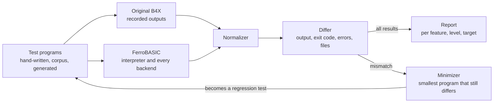

# Compatibility testing

Compatibility is measured, not claimed: the same programs run on the original
B4X toolchain and on FerroBASIC, and every difference in observable behaviour
is either a bug or a documented deviation. It starts in M0 and becomes the gate
of every milestone.



## The oracle

- Levels 0–2: the original B4J compiles each console program from the command
  line and runs it on the JVM. B4A follows on an Android emulator (comparing
  logcat), B4R on real boards (comparing serial output).
- What counts as behaviour: `Log` output, exit status, uncaught exceptions
  (type, not message text), files written.
- Negative tests: an invalid program must be rejected by both toolchains; error
  messages are not compared.

## Record and replay

- B4X is proprietary and its IDE runs on Windows, so it does not run in CI. A
  recording machine runs each test once on the reference (`tools/recorder`) and
  commits `*.expected` with a `*.meta.toml`: B4X version, platform, date.
- CI compares FerroBASIC's outputs with the recordings only. A new B4X release
  triggers a re-recording, and changes between versions are reported.

## Test file layout

```text
tests/conformance/level0/
  <name>.bas          program body (code module, B4J console)
  <name>.meta.toml    status, level, features, and recording metadata
  <name>.expected     recorded output (written only by tools/recorder)
  <name>.provisional  hand-derived output, used only while there is no .expected
```

`status` in `.meta.toml` is one of `pending-recording`, `recorded`,
`deviation` (see `docs/deviations.md`) or `negative` (must be rejected).
A test whose program must stop on an uncaught error names its kind in
`uncaught_error` (for example `"java.lang.RuntimeException"`).

### Provisional outputs

While the recorder does not exist, a test may carry a `<name>.provisional`
file: its expected stdout, derived by hand from the sources in
[research/level0-semantics.md](research/level0-semantics.md). Rules:

- Only for behaviour the research marks as settled by `source`, `docs` or
  `forum`; the basis and the links go in a `[provisional]` table of the
  `.meta.toml`. Behaviour marked *open* gets no provisional output: the test
  stays pending with no expectation.
- A `.provisional` file never overrides an `.expected` one. When the recorder
  writes `<name>.expected`, it deletes `<name>.provisional` and the
  `[provisional]` table; a disagreement between the two is reported, and the
  research and specs are fixed to match the recording.
- The report counts passes against provisional outputs separately from passes
  against recordings. Only the latter count for a milestone gate from M2 on.
- Values computed by running Java code from the open-source runtime (for
  example number formatting) are `source` basis; record the JDK version used.

## Where test programs come from

1. Hand-written conformance tests, at least one per language feature.
2. A real-world corpus of open source B4X projects whose licences allow it,
   first measured as parse rate and type-check rate (`tests/corpus/`).
3. Generated programs (`crates/progen`): a generator driven by the EBNF and the
   type rules produces well-typed, terminating Level 0 programs with bounded
   loops. Each mismatch is shrunk by delta debugging and kept as a regression test.

## Normalization

- Line endings, temporary paths and timestamps are normalized.
- Number-to-string formatting is visible behaviour, so it must match B4X, not
  be normalized away.
- `Map` iteration order must match B4X too (insertion order, to verify).

## The report

A compatibility matrix by feature, language level and target, with four states:
pass, fail, documented deviation, pending. Accepted deviations live in
`docs/deviations.md`.

The headline number, per target, is the share of corpus projects that build
without changes and behave identically to the original.

## Open points

Tracked in [open-questions.md](open-questions.md#compatibility-testing).
